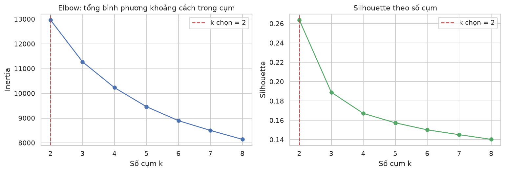
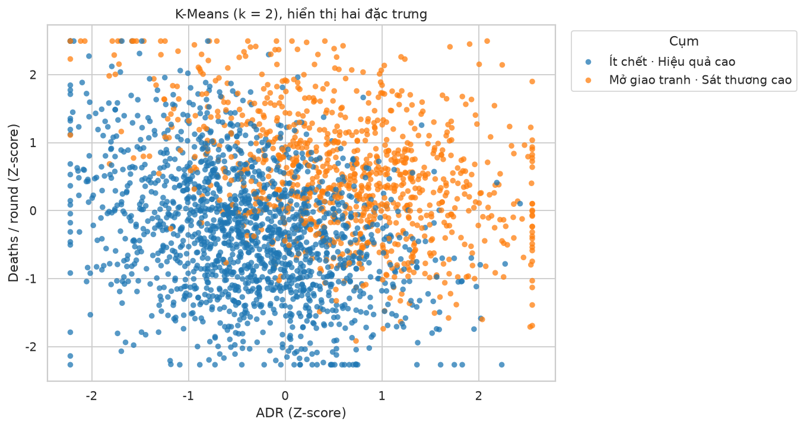
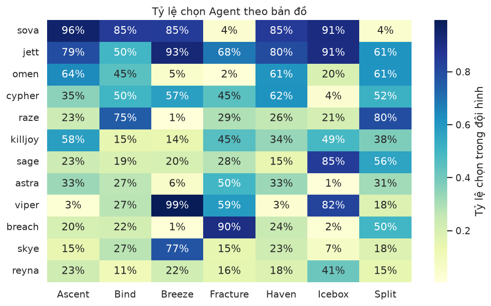
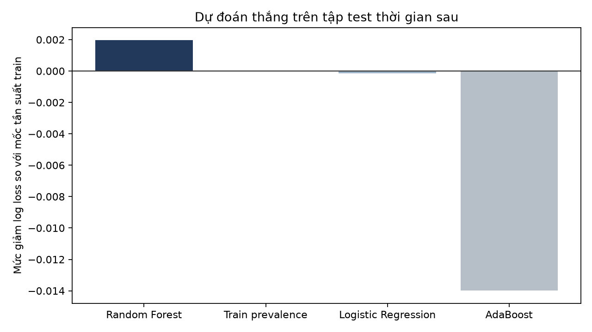

# Giải thích đề tài, thuật toán và cách bảo vệ đồ án

Cập nhật theo mã nguồn và kết quả chạy ngày 19/11/2026. Đọc nhanh các mục 1, 5, 6, 9 và 10 trước khi thuyết trình.

## Mục lục

- [1. Đề tài và mục tiêu](#1-đề-tài-và-mục-tiêu)
- [2. Dữ liệu và đơn vị phân tích](#2-dữ-liệu-và-đơn-vị-phân-tích)
- [3. Khảo sát và tiền xử lý](#3-khảo-sát-và-tiền-xử-lý)
- [4. Nguyên lý thuật toán](#4-nguyên-lý-thuật-toán)
- [5. Thiết kế thực nghiệm](#5-thiết-kế-thực-nghiệm)
- [6. Kết quả và giải thích](#6-kết-quả-và-giải-thích)
- [7. Phương pháp hiện đại và mức đáp ứng yêu cầu](#7-phương-pháp-hiện-đại-và-mức-đáp-ứng-yêu-cầu)
- [8. Kết luận, hạn chế và hướng phát triển](#8-kết-luận-hạn-chế-và-hướng-phát-triển)
- [9. Dàn ý thuyết trình 13 phút](#9-dàn-ý-thuyết-trình-13-phút)
- [10. Câu hỏi bảo vệ](#10-câu-hỏi-bảo-vệ)
- [11. Chạy lại và tìm mã nguồn](#11-chạy-lại-và-tìm-mã-nguồn)
- [12. Tài liệu tham khảo](#12-tài-liệu-tham-khảo)

## 1. Đề tài và mục tiêu

**Tên đề tài đề xuất — Khai phá dữ liệu thi đấu Valorant để phân tích tuyển thủ, tổ hợp Agent và khả năng dự đoán kết quả.**

Valorant có nhiều map, Agent, vai trò và bản cập nhật. Một lựa chọn Agent có thể phổ biến trên map này nhưng ít xuất hiện trên map khác. Thống kê tuyển thủ cũng chịu ảnh hưởng vai trò và số lần thi đấu. Đồ án sử dụng dữ liệu trận thực tế để tìm cấu trúc, mẫu đồng xuất hiện và tín hiệu dự đoán trong các lựa chọn đó.

Ba mục tiêu thực nghiệm chính là phân nhóm tuyển thủ có thống kê tương tự, tìm Agent thường được chọn cùng nhau trên từng map và đo khả năng dự đoán thắng bằng thông tin trước trận. Giao diện giúp người xem tra cứu các kết quả Agent, đội hình và chỉ số tuyển thủ.

| Câu hỏi | Đơn vị phân tích | Đầu vào | Phương pháp | Đầu ra |
|---|---|---|---|---|
| Tuyển thủ có các nhóm thống kê nào? | Một tuyển thủ | 7 đặc trưng số đã chuẩn hóa | K-Means, Average linkage | Nhãn cụm, kích thước, chân dung cụm |
| Agent nào thường đi cùng nhau trên map? | Một đội trong một ván | Giao dịch 5 Agent | Apriori, FP-Growth | Tập phổ biến, luật, support/confidence/lift |
| Đội hình giúp dự đoán thắng đến đâu? | Một ván có hai đội | Map, patch, chênh lệch chọn Agent | Logistic Regression, Random Forest, AdaBoost | Xác suất thắng và bảng đánh giá |

## 2. Dữ liệu và đơn vị phân tích

### Nguồn SQLite cho thực nghiệm

File `data/raw/valorant.sqlite` đi kèm repository. Các bảng chính gồm `Matches` về trận, ngày, giải và patch, `Games` về từng map và kết quả, `Game_Scoreboard` về thống kê tuyển thủ, `Game_Rounds` về lịch sử round. Repository hiện chưa ghi rõ nguồn thu thập upstream của SQLite, vì vậy khi báo cáo cần dẫn repository và mô tả đúng giới hạn nguồn đã xác minh.

Sau làm sạch, dữ liệu có **14.005 ván**, **28.010 lượt đội hình**, **140.050 dòng tuyển thủ–ván** và **27.382 lượt đội hình có nhãn thắng/thua**. Phạm vi từ 05/2020 đến 01/2022, gồm Ascent, Bind, Breeze, Fracture, Haven, Icebox và Split. Phần phân cụm có **2.599 tuyển thủ** vượt qua các điều kiện tối thiểu.

Một trận có thể gồm nhiều ván trên các map. Một ván có hai đội hình và mười dòng thống kê tuyển thủ. Số dòng scoreboard vì thế khác số tuyển thủ duy nhất.

### Nguồn VCT cho hồ sơ tuyển thủ

`scripts/10_build_vct_player_profiles.py` tải VCT Reference để tạo radar ACS, ADR, K/D, hỗ trợ/round, first kills/round và KAST. Snapshot đã tải có 73.976 dòng tuyển thủ–map và tạo 6.285 hồ sơ theo mùa/map của 652 tuyển thủ đủ điều kiện. Giao diện hiện dùng hồ sơ tổng hợp cả mùa và cho chọn mùa/tên.

Ngày trận trong snapshot VCT từ 08/03/2021 đến 18/10/2026. URL và SHA-256 được lưu trong `data/processed/vct_player_profiles_source.json`. Bộ VCT phục vụ hồ sơ tuyển thủ, các kết quả phân cụm/luật/dự đoán bên dưới sử dụng SQLite.

## 3. Khảo sát và tiền xử lý

### Đặc điểm cần quan sát

Kiểm tra kích thước, kiểu thuộc tính, khóa trùng, phân phối theo map/ngày, dữ liệu thiếu và ngoại lệ. Map có số ván chênh lệch rõ, Ascent có 3.403 ván trong khi Fracture có 99 ván. Một tỉ lệ trên Fracture dễ dao động hơn tỉ lệ trên map có hàng nghìn ván.

Trong scoreboard sạch, ACS có khoảng 99,93% giá trị, ADR khoảng 96,77%, còn KAST chỉ khoảng 2,18%. KAST vì thế được loại khỏi phân cụm SQLite. Giá trị thiếu của một chỉ số không được xem như tuyển thủ đạt 0 ở chỉ số đó.

### Các bước đã triển khai

1. Làm sạch map, khóa, Agent và số round. Kiểm tra mỗi đội có năm Agent khác nhau, mỗi ván có hai đội hình.
2. Đối chiếu nhãn thắng với `Games.Winner`, giữ các dòng thiếu nhãn ngoài bài toán dự đoán.
3. Tổng hợp chỉ số theo PlayerID. Yêu cầu ít nhất 10 ván, 100 round, độ phủ ACS/ADR/HS ít nhất 80% và đủ biến mô hình.
4. Tính biến đếm trên round để so sánh người có số ván khác nhau. Ví dụ assists/round bằng tổng assists chia tổng rounds. ACS/ADR/HS được lấy trung bình theo round có ghi nhận chỉ số.
5. Chọn ADR, deaths/round, assists/round, first kills/round, first deaths/round, độ lệch chuẩn ACS và HS để phân cụm. Dùng một biến sát thương chính giúp giảm việc đếm lặp các biến tương quan như ACS, ADR và kills.
6. Chặn giá trị cực đoan tại phân vị 1% và 99%, rồi chuẩn hóa Z-score bằng công thức `z = (x − trung bình) / độ lệch chuẩn`.

Z-score đưa các thang đo về mức so sánh được trước khi tính khoảng cách Euclidean. Ví dụ ADR có giá trị hàng trăm, trong khi assists/round có thể chỉ khoảng 0,2. Các tham số chuẩn hóa này dùng cho phân tích cụm mô tả toàn tập. Bộ mã hóa của phân lớp được fit trên train.

## 4. Nguyên lý thuật toán

### K-Means

K-Means chia các điểm thành k cụm bằng cách giảm tổng bình phương khoảng cách từ mỗi điểm đến tâm cụm. Khởi tạo k tâm, gán mỗi tuyển thủ vào tâm gần nhất, cập nhật tâm bằng trung bình các điểm được gán và lặp đến khi hội tụ. Khoảng cách sử dụng các đặc trưng đã chuẩn hóa.

Thuật toán phù hợp dữ liệu số và có thể diễn giải cụm qua trung bình từng chỉ số. Kết quả phụ thuộc k, thang đo và hình dạng cụm. Mã thử k từ 2 đến 8, chọn silhouette cao nhất trong khoảng đã thử, dùng nhiều lần khởi tạo và random_state=42.

### Phân cụm phân cấp Average linkage

Bắt đầu với mỗi tuyển thủ là một cụm. Tính khoảng cách trung bình giữa mọi cặp điểm của hai cụm, hợp nhất cặp cụm có khoảng cách nhỏ nhất rồi lặp đến số cụm cần có. Chạy trên cùng ma trận chuẩn hóa và cùng k với K-Means để đối chiếu.

Average linkage có thể tách nhóm ngoại lệ nhỏ ra khỏi phần còn lại. Cần xem kích thước cụm cùng các chỉ số đánh giá.

### Apriori

Mỗi giao dịch là năm Agent của một đội trên một map. Apriori tìm tập một mục phổ biến, ghép chúng thành ứng viên lớn hơn và quét để đếm support. Tính chất dùng để cắt giảm tìm kiếm là nếu một tập không phổ biến thì mọi tập chứa nó cũng không phổ biến.

### FP-Growth

FP-Growth cũng tìm tập phổ biến nhưng nén các giao dịch thành FP-tree, chia thành các bài toán điều kiện rồi khai phá. Cấu trúc này tránh tạo tập ứng viên như Apriori. Cả hai dùng cùng ngưỡng phải tìm cùng tập phổ biến, thời gian có thể khác theo dữ liệu và triển khai.

Với luật `A → B`, support bằng `số giao dịch chứa A và B / tổng giao dịch`. Confidence bằng `support(A ∪ B) / support(A)`. Lift bằng `confidence / support(B)`. Lift lớn hơn 1 mô tả mức đồng xuất hiện vượt kỳ vọng độc lập. Luật không sử dụng thứ tự thời gian nên mũi tên không chứng minh A gây ra B.

### Logistic Regression

Mô hình tính tổng có trọng số của các đặc trưng và chuyển thành xác suất bằng sigmoid `p = 1 / (1 + exp(−z))`. Huấn luyện tối ưu log loss có điều chuẩn. Đây là mô hình phân lớp nhị phân cơ sở, thích hợp để kiểm tra mức cải thiện của các mô hình cây.

### Random Forest

Random Forest tạo nhiều cây từ các mẫu bootstrap, mỗi lần chia nút xét một tập đặc trưng ngẫu nhiên rồi tổng hợp xác suất của các cây. Việc kết hợp giúp giảm phương sai của cây đơn. Cấu hình hiện tại có 300 cây, max_depth=8, min_samples_leaf=30, max_features=sqrt, random_state=42.

### AdaBoost

AdaBoost huấn luyện các bộ phân loại yếu theo thứ tự. Sau mỗi lượt, tăng trọng số tương đối của các mẫu bị phân loại sai để lượt sau tập trung hơn vào chúng, sau đó kết hợp các bộ phân loại. Cấu hình hiện tại dùng 200 cây một mức, learning_rate=0,05, random_state=42. Mô hình có thể nhạy với nhiễu và xác suất đầu ra cần được đánh giá bằng log loss/Brier.

## 5. Thiết kế thực nghiệm

| Phần | Cách so sánh công bằng | Tiêu chí |
|---|---|---|
| Phân cụm | Cùng 7 đặc trưng, Z-score và k | Silhouette, kích thước cụm, ARI giữa hai thuật toán |
| Luật | Cùng map, support tối thiểu max(12/n, 0,02), max_len=3, confidence≥0,4, lift≥1,05 | Tập phổ biến bằng nhau, số luật, thời gian |
| Phân lớp | Cùng đặc trưng và train/test theo thời gian | Accuracy, AUC, log loss, Brier, khoảng tin cậy |

Silhouette so độ gần trong cụm với khoảng cách đến cụm khác, cao hơn thường là tốt hơn. ARI đo độ đồng thuận hai cách chia, 1 là trùng nhau và gần 0 là mức đồng thuận gần ngẫu nhiên. Bước ổn định K-Means lấy ngẫu nhiên 80% tuyển thủ, không hoàn lại, thực hiện 30 lần rồi đối chiếu nhãn bằng ARI. Trong mã bước này có tên `stability_bootstrap`, nhưng thực tế là phép lấy mẫu con.

Mỗi ván dự đoán chỉ tạo một dòng. Đội đích chọn theo thứ tự chữ cái mã đội, vì Team1 trong dữ liệu gốc thắng khoảng 76,8% và có thể phản ánh cách ghi dữ liệu. Với từng Agent, đặc trưng bằng 1 khi chỉ đội đích chọn, −1 khi chỉ đối phương chọn và 0 khi cả hai cùng chọn hoặc đều không chọn.

Train có 11.182 ván trước 22/09/2021. Test có 2.509 ván từ 22/09/2021 đến 08/01/2022, thuộc 1.239 trận. Mã kiểm tra GameID và MatchID không trùng giữa train/test. Tham số mô hình được định trước, test dùng cho đánh giá.

Accuracy đo tỷ lệ đoán đúng. AUC đo khả năng xếp hạng đội thắng cao hơn đội thua, mốc ngẫu nhiên là 0,5. Log loss phạt mạnh các dự đoán sai nhưng quá tự tin. Brier là trung bình bình phương sai số xác suất. Log loss và Brier càng thấp càng tốt.

Mốc so sánh luôn dự đoán xác suất bằng tỷ lệ thắng train. Khoảng tin cậy của mức giảm log loss được tạo bằng 2.000 lần bootstrap theo MatchID để các ván cùng trận đi cùng nhau. ACS hoặc KAST của chính trận cần dự đoán không có sẵn trước trận nên không đưa vào đầu vào dự đoán.

## 6. Kết quả và giải thích

### Phân cụm 2.599 tuyển thủ

| Phương pháp | Số cụm | Kích thước | Silhouette |
|---|---:|---|---:|
| K-Means | 2 | 962 và 1.637 | 0,2638 |
| Average linkage | 2 | 2.596 và 3 | 0,2769 |

Độ ổn định K-Means đạt ARI trung bình 0,9742. Average linkage có ARI với K-Means khoảng −0,0001, thể hiện hai cách chia rất khác nhau. Silhouette cao hơn một chút của Average linkage đi cùng việc tách ba điểm ra khỏi hầu hết tập, nên không thể chỉ dựa một chỉ số để chọn mô hình.

Nhóm K-Means 962 người có ADR trung bình 139,49, first kills/round 0,1376 và deaths/round 0,7410. Nhóm 1.637 người có ADR 124,32, first kills/round 0,0739, deaths/round 0,6990 và assists/round cao hơn (0,2747 so với 0,2130). Có thể diễn giải hai nhóm theo mức giao tranh/mở đầu và mức hỗ trợ/ít tử vong.

Nhãn tự động của nhóm thứ hai trong CSV là “Ít chết · Hiệu quả cao”. Khi bảo vệ nên dùng mô tả chỉ số cụ thể, vì K/D trung bình nhóm này là 0,9505, thấp hơn 1,0295 của nhóm thứ nhất. Nhãn diễn giải không phải nhãn chuyên môn đã được xác nhận.




### Luật kết hợp

Apriori và FP-Growth tìm cùng tập phổ biến trên cả 7 map, sinh tổng 580 luật sau lọc. Ví dụ Ascent có 175 tập phổ biến và 102 luật, Bind có 207 tập và 127 luật. Trong lần chạy này Apriori nhanh hơn FP-Growth. Tập Agent nhỏ và giao dịch chỉ dài năm mục, nên không suy rộng thứ tự tốc độ này cho mọi dữ liệu. Thời gian ghi nhận là một lần chạy và chỉ gồm bước tìm tập phổ biến.

Sau kiểm định Fisher và hiệu chỉnh BH, 17 luật và 3/473 đội hình kiểm định còn khác biệt theo ngưỡng q<0,05 của pipeline. Đây là quan hệ trong dữ liệu quan sát, còn phụ thuộc đội, patch và đối thủ. Support/confidence/lift dùng cho đồng xuất hiện, win rate dùng cho kết quả thi đấu.



### Dự đoán trên 2.509 ván test

| Phương pháp | Accuracy | AUC | Log loss | Brier |
|---|---:|---:|---:|---:|
| Random Forest | 52,93% | 0,5347 | 0,6907 | 0,2488 |
| AdaBoost | 52,97% | 0,5299 | 0,7067 | 0,2560 |
| Logistic Regression | 51,53% | 0,5317 | 0,6928 | 0,2498 |
| Tần suất train | 52,09% | 0,5000 | 0,6927 | 0,2498 |

Random Forest có log loss tốt nhất. Mức giảm so mốc là 0,001973, khoảng bootstrap 95% từ 0,000117 đến 0,003690. AdaBoost có accuracy cao hơn Random Forest một ván test, nhưng chất lượng xác suất kém hơn mốc. Logistic Regression cải thiện rất ít về xếp hạng, mức chênh log loss có khoảng tin cậy chạm 0.

Các kết quả này cho thấy lựa chọn Agent/map/patch có tín hiệu dự đoán nhỏ. Chưa có đủ thông tin để dự đoán thắng mạnh khi thiếu sức mạnh đội và phong độ trước trận.



## 7. Phương pháp hiện đại và mức đáp ứng yêu cầu

Các phương pháp đang chạy được lựa chọn theo nội dung môn học. Apriori, FP-Growth, K-Means, Average linkage, Logistic Regression, Random Forest và AdaBoost đều là các phương pháp kinh điển. Việc so sánh nhiều thuật toán đáp ứng nội dung thực nghiệm, còn câu “ít nhất hai thuật toán hoặc phương pháp mới nhất” chưa thể coi là đã đáp ứng chỉ bằng các thuật toán này.

Để tìm hiểu lý thuyết hiện đại, có thể trình bày LightGBM và CatBoost. LightGBM tối ưu gradient boosting cây, bài báo giới thiệu GOSS và EFB để giảm chi phí xử lý dữ liệu. CatBoost giới thiệu ordered boosting và cách xử lý thuộc tính phân loại nhằm hạn chế prediction shift. Các bài báo lần lượt công bố năm 2017 và 2018, nên cách gọi phù hợp là các đối chứng boosting hiện đại, không khẳng định chúng mới nhất năm 2026. [LightGBM](https://papers.neurips.cc/paper/2017/hash/6449f44a102fde848669bdd9eb6b76fa-Abstract.html), [CatBoost](https://proceedings.neurips.cc/paper_files/paper/2018/hash/14491b756b3a51daac41c24863285549-Abstract.html)

Bản hiện tại đã thay hai mô hình đó theo yêu cầu sử dụng phương pháp đã học. Phần này là đối chiếu lý thuyết. Bảng kết quả chính ở mục 6 thuộc các mô hình hiện đang chạy. Cần xác nhận cách hiểu yêu cầu “mới nhất” với giảng viên trước khi nộp.

## 8. Kết luận, hạn chế và hướng phát triển

Đồ án đã thực hiện đủ ba hướng khai phá với dữ liệu thực tế và có quy trình chạy lại. K-Means tạo hai nhóm có mức giao tranh/hỗ trợ khác nhau. Apriori và FP-Growth khôi phục cùng các mẫu chọn Agent, Random Forest đem lại mức cải thiện xác suất nhỏ so mốc.

Giới hạn gồm dữ liệu đội hình cũ, nguồn upstream SQLite chưa rõ, vai trò Agent gây nhiễu cách diễn giải phong cách, KAST thiếu trong nguồn gốc và thiếu thông tin sức mạnh đội. Silhouette 0,264 cho thấy cụm còn chồng lấn. Kết quả test chỉ thuộc một giai đoạn, 85,2% ván test thuộc patch chưa có trong train.

Hướng tiếp theo là bổ sung dữ liệu có nguồn rõ, đánh giá nhiều cửa sổ thời gian, so tuyển thủ cùng vai trò, dùng lịch sử phong độ đội trước trận và xác suất đã hiệu chỉnh trên tập validation riêng. Có thể mở rộng bộ dựng đội hình từ luật kết hợp, với cỡ mẫu hiển thị phù hợp cho người xem.

## 9. Dàn ý thuyết trình 13 phút

| Thời gian | Nội dung | Điều cần thể hiện |
|---|---|---|
| 0–1,5 phút | Bài toán và mục tiêu | Ba câu hỏi nghiên cứu, ứng dụng tra cứu Valorant |
| 1,5–3,5 phút | Dữ liệu | Bảng nguồn, đơn vị ván/đội/tuyển thủ, số lượng, thiếu KAST, mất cân bằng map |
| 3,5–7 phút | Tiền xử lý và thuật toán | Z-score, K-Means/Average linkage, Apriori/FP-Growth, ba mô hình phân lớp |
| 7–11 phút | Kết quả | Hai nhóm tuyển thủ, cùng 580 luật, bảng dự đoán và lý do AdaBoost accuracy cao nhưng log loss xấu |
| 11–13 phút | Kết luận và demo | Bộ lọc map, đội hình, radar, giới hạn và hướng phát triển |

Mở đầu có thể nói “Nhóm sử dụng dữ liệu trận Valorant để tìm các nhóm thống kê tuyển thủ, khai phá Agent thường đi cùng nhau trên từng map và kiểm tra khả năng dự đoán thắng từ đội hình. Các kết quả được đưa lên trang tra cứu để người xem khám phá.”

Nếu có ba thành viên, có thể chia phụ trách dữ liệu/tiền xử lý, phân cụm/luật và phân lớp/giao diện. Mọi thành viên cần nắm đầu vào, cách đánh giá và giới hạn của cả ba bài toán. Tên nhóm và phân công thực tế do nhóm tự điền.

## 10. Câu hỏi bảo vệ

**Tại sao dùng Z-score?** Để các biến như ADR và assists/round có trọng số khoảng cách hợp lý sau khi đưa về cùng thang đo.

**Tại sao chọn k=2?** Trong khoảng thử 2–8, k=2 có silhouette cao nhất trên ma trận bảy đặc trưng đã chuẩn hóa. Đây là tốt nhất trong các cấu hình đã thử.

**Average linkage silhouette cao hơn thì có tốt hơn không?** Cần xét mục đích và kích thước, kết quả 2.596/3 chủ yếu tách một nhóm nhỏ. K-Means cho hai nhóm cân đối hơn và có thể diễn giải theo thống kê.

**Apriori khác FP-Growth thế nào?** Apriori sinh và đếm ứng viên theo độ dài tập, FP-Growth nén giao dịch thành cây và khai phá các cơ sở điều kiện. Kết quả tập phổ biến phải đồng nhất khi cùng tham số.

**Lift cao có chứng minh đội hình mạnh không?** Lift mô tả đồng xuất hiện. Hiệu suất cần xem nhãn thắng, cỡ mẫu và các yếu tố gây nhiễu.

**Tại sao không dùng ACS của trận để dự đoán thắng trận đó?** ACS của trận chỉ có sau khi thi đấu, đưa vào mô hình trước trận sẽ rò rỉ thông tin tương lai.

**Vì sao AdaBoost accuracy cao nhất nhưng không tốt nhất?** Accuracy xét phía nào của ngưỡng 0,5. Log loss đánh giá cả mức tự tin của xác suất và phạt dự đoán sai quá tự tin.

**Vì sao chỉ đoán đúng khoảng 53%?** Đội hình chỉ là một phần của kết quả. Dữ liệu mô hình chưa có chất lượng đội, đối thủ, chiến thuật và phong độ.

**Tại sao bootstrap theo trận?** Các ván cùng MatchID có liên quan, lấy lại mẫu theo trận giữ cấu trúc phụ thuộc trong khối.

**Có đáp ứng hai phương pháp mới nhất chưa?** Bản chính bám chương trình học. Yêu cầu về thuật toán mới nhất cần được xác nhận và có thể bổ sung thực nghiệm riêng nếu giảng viên yêu cầu.

## 11. Chạy lại và tìm mã nguồn

```powershell
python -m pip install -r requirements.txt
python scripts/run_pipeline.py
python scripts/04_make_report.py
python -m http.server 8765 --bind 127.0.0.1
```

Mở `http://127.0.0.1:8765/dashboard/`. Các bảng và hình dùng trong tài liệu được tạo bởi pipeline. Khi thay dữ liệu hoặc tham số, cần cập nhật các số trong tài liệu này từ bảng mới.

| Nội dung | File |
|---|---|
| Làm sạch | `src/valorant_mining/cleaning.py` |
| Đặc trưng tuyển thủ | `src/valorant_mining/features.py` |
| Chuẩn hóa và phân cụm | `src/valorant_mining/clustering.py` |
| Apriori, FP-Growth và kiểm định | `src/valorant_mining/rules.py` |
| Phân lớp và chia thời gian | `scripts/07_compare_predictors.py` |
| Hồ sơ VCT | `scripts/10_build_vct_player_profiles.py` |
| Toàn bộ quy trình | `scripts/run_pipeline.py` |
| Kết quả cụm | `outputs/tables/clustering_summary.csv` |
| So sánh luật | `outputs/tables/association_comparison.csv` |
| So sánh phân lớp | `outputs/tables/predictor_comparison.csv` |

## 12. Tài liệu tham khảo

- Repository dữ liệu và mã nguồn [Data-Mining-](https://github.com/DucZaki/Data-Mining-).
- Nguồn hồ sơ tuyển thủ [VCT Reference Dataset](https://vct-reference.com/dataset).
- Slide môn học do nhóm cung cấp danh sách thuật toán, khi làm báo cáo chính thức cần bổ sung tên giảng viên, học phần và năm học.
- Ke và cộng sự, 2017, [LightGBM, NeurIPS](https://papers.neurips.cc/paper/2017/hash/6449f44a102fde848669bdd9eb6b76fa-Abstract.html).
- Prokhorenkova và cộng sự, 2018, [CatBoost, NeurIPS](https://proceedings.neurips.cc/paper_files/paper/2018/hash/14491b756b3a51daac41c24863285549-Abstract.html).
